# ⛩️ ENHANCE PRD v2.0 — Sacred Neo-Shinto 3D Sanctuary
**Dokumen:** Product Requirements Document & Blueprint Redesain Arsitektur Menyeluruh  
**Pemilik Proyek:** Irfandy Aziz — Full-Stack Developer / IT Developer  
**Konsep Utama:** *Jinja Keidai* (神社境内) — *Sacred Neo-Shinto Shrine Complex & Cyber-Sanctuary*  
**Tech Stack:** React 19 + TypeScript + Three.js + React Three Fiber (R3F) + Drei + Postprocessing + Tailwind CSS v4  
**Versi Dokumen:** `2.0.0` (Full-Page Overhaul Blueprint dari `PLANNING.md` v1.0)

---

## 1. Executive Summary & Visi Redesain

Pada versi `1.0` sebelumnya, nuansa **Japanese Shrine** hanya terasa pada dua layar awal (*Torii Gate Intro* dan *Hero Shrine*). Begitu pengguna melakukan *scroll* ke Chamber `02` hingga `07`, dunia 3D berubah menjadi kumpulan objek geometris acak (*server box* dan oktahedron melayang, cincin torus polos, balok platonic solids, serta *grid* lantai datar) tanpa benang merah visual, dengan warna monoton Cyan (`#00f0ff`) dan Magenta (`#ff0055`) yang lebih menyerupai *arcade retro synthwave* ketimbang kompleks kuil Jepang yang sinematik.

**ENHANCE PRD v2.0** merancang ulang **seluruh pengalaman halaman (100% 3D Scene, Tekstur PBR, Pencahayaan, Warna/Gradasi, Tipografi, UI/HUD, dan 7 Chamber + Intro Gate)** menjadi **satu kesatuan kompleks kuil Shinto modern di malam hari (*Yozakura & Sacred Sanctuary at Night*)**.

### 4 Pilar Transformasi v2.0
1. **Kesatuan Konsep Spasial (*Continuous Shrine Pilgrimage*):** Pengunjung tidak lagi melihat objek acak muncul-hilang di tempat yang sama, melainkan berjalan menyusuri jalan batu suci (*Sandō* / 参道) melewati 8 titik arsitektur kuil yang autentik dari gerbang luar hingga pagoda puncak.
2. **Arsitektur 3D Kurva Autentik (*Non-Primitive Japanese Geometry*):** Menghilangkan atap kerucut kaku (`coneGeometry`) dan balok lurus; menggantinya dengan lengkungan atap *Irimoya* (*Sori*), palang *Myōjin Torii* melengkung, tali suci *Shimenawa*, lentera batu *Ishi-dōrō*, jembatan lengkung *Taiko-bashi*, papan *Ema*, gulungan *Kakemono*, dan pagoda 5 tingkat *Gojunotō*.
3. **Tekstur Prosedural PBR & Refleksi Basah (*Zero-Bloat High Craft*):** Membuat generator tekstur Canvas2D/WebGL prosedural (*diffuse, bump, roughness, emissive*) untuk kayu pernis merah *Shu-iro*, cedar gelap *Kuro-Hinoki*, batu basal pahatan, sepuhan emas *Kinpaku*, dan kertas *Washi Shoji*—dipadukan dengan `<Environment>` reflections dan lantai pelataran batu basah reflektif (`MeshReflectorMaterial`).
4. **Cinematic Color Grading & Neo-Shinto UI:** Meninggalkan duotone Cyan/Pink polos menuju palet multi-stop berkelas: **Shrine Vermilion (`#e11d48`)**, **Kinpaku Gold (`#fbbf24`)**, **Lantern Amber (`#f59e0b`)**, **Kitsunebi Spirit Jade (`#2dd4bf`)**, **Yozakura Blossom (`#fb7185`)**, di atas **Obsidian Hinoki (`#05070b`)**.

---

## 2. Audit Kritis v1.0: Mengapa Section 2–7 Terlihat "Random Tanpa Konsep"?

Tabel diagnostik berikut membedah kondisi implementasi saat ini (`v1.0`) berdasarkan kode sumber aktual dan menetapkan arah perombakan (`v2.0`) pada setiap modul:

| Modul / Chamber | File Saat Ini (`v1.0`) | Masalah Utama (`v1.0` Diagnosis) | Solusi Arsitektur Baru (`v2.0` Redesign) |
| :--- | :--- | :--- | :--- |
| **Pre-Entry Gate** | `ToriiGate3D.tsx` `CyberKitsune3D.tsx` `GateIntroPrompt.tsx` | Palang atas Torii hanya `boxGeometry` lurus tanpa lengkungan *Sori*, tanpa papan kaligrafi *Gaku*, tanpa *Shimenawa*. Patung Kitsune berupa tumpukan kotak & silinder dengan *wireframe* tempelan; material `metalness: 0.9` memantulkan ruang kosong hitam. | **Ichi-no-Torii & Komagitsune:** Palang melengkung *Myōjin Torii* dengan `CatmullRomCurve3` / `ExtrudeGeometry`, papan kaligrafi menyala `電脳神社`, tali *Shimenawa* + *Shide*, serta patung Kitsune obsidian berpendar *Kitsunebi Jade* & *Vermilion* dengan halo mandala berputar. |
| **Chamber 01: Hero** | `CyberShrine3D.tsx` `HeroSection.tsx` | Atap kuil memakai `coneGeometry` 4 sisi kaku; *mesh* neon cyan (`args={[1.94, 0.62, 4]}`) lebih besar sehingga menelan *mesh* kayu di dalamnya. Lentera terlalu kecil dan datar. | **Haiden Main Worship Hall (拝殿):** Aula utama kuil berarsitektur atap *Irimoya* melengkung bertingkat, pilar kayu *Shu-iro* & *Kinpaku*, beranda *Koran*, tangga batu, lentera *Tōrō* kiri-kanan berapi redup, serta interior *Shoji* bertekstur *Kumiko* hangat. |
| **Chamber 02: Dossier** | `DataCitadel3D.tsx` `DossierSection.tsx` | **Paling melenceng:** Menampilkan 2 menara *server rack* kotak dan 12 oktahedron acak melayang. Tidak ada relevansi sama sekali dengan tema kuil Jepang. | **Chōzuya & Ema-den Pavilion (手水舎・絵馬殿):** Paviliun kayu kuil beratap lengkung dengan rak papan kayu doa **Ema** berukir segel *Ofuda* emas/jade + kolom air suci reflektif (*Chōzuya*), menyimbolkan identitas & matriks keahlian sang arsitek sistem. |
| **Chamber 03: Showcase** | `HologramStation3D.tsx` `ShowcaseSection.tsx` | Hanya 3 buah `ringGeometry` tipis di lantai + silinder cahaya polos tanpa konteks budaya Jepang. | **Kagura-den & Yata-no-Kagami Stage (神楽殿・八咫鏡):** Panggung kayu suci kuil berpagar *Koran* merah-emas dengan **Cermin Sakral *Yata-no-Kagami*** & cincin segel *Shinto Tomoe* berputar sebagai proyektor hologram karya-karya *enterprise*. |
| **Chamber 04: Career** | `ChronoStream3D.tsx` `CareerSection.tsx` | Hanya 4 *torus* neon dan 4 garis rel lantai dengan kotak putih meluncur—murni *sci-fi generic*. | **Senbon Torii Chronicle Corridor (千本鳥居):** Koridor perspektif deretan gerbang **Torii Merah (*Senbon Torii*)** yang membentang ke kedalaman kabut, di mana 4 gerbang utama bersinar penanda 4 era karier (`2019–2026`) lengkap dengan lentera batu *Tōrō* berjarak teratur. |
| **Chamber 05: Academic** | `NeuralLattice3D.tsx` `AcademicSection.tsx` | Hanya 1 oktahedron cyan, 1 icosahedron pink, dan 1 balok garis lurus penghubung; terasa sangat kosong dan generik. | **Taiko-bashi & Kyōzō Scroll Repository (太鼓橋・経蔵):** Jembatan lengkung merah kuil (*Taiko-bashi*) melintasi refleksi air suci, diapit **2 Gulungan Kitab Agung (*Kakemono Scrolls*)** melayang dengan segel *Hanko* menyala yang melambangkan fondasi SMK RPL dan D3 Manajemen Informatika. |
| **Chamber 06: Services** | `CapabilitiesCluster3D.tsx` `ServicesSection.tsx` | 6 *Platonic solids* acak (`dodeca`, `octa`, `icosa`, `cylinder`, `torus`, `box`) melayang tanpa pijakan arsitektur. | **Rokkakudō & Six Sacred Tōrō Shrines (六角堂・六灯籠):** Paviliun atap heksagonal di tengah yang dikelilingi **6 Lentera Batu Suci (*Ishi-dōrō*)** tersusun melingkar membentuk altar 6 kapabilitas layanan profesional dengan pendar api emas & jade. |
| **Chamber 07: Contact** | `UplinkBeacon3D.tsx` `ContactSection.tsx` | 1 silinder sinar laser vertikal dan 3 cincin torus berputar; tampak seperti stasiun satelit luar angkasa. | **Gojunotō Five-Story Pagoda & Suzu Bell Altar (五重塔・神鈴):** Pagoda kuil **5 tingkat** yang menjulang megah di latar belakang dengan *Sōrin* (puncak antena emas pagoda) yang memancarkan suar cahaya emas-jade ke langit malam, serta tali lonceng kuil (*Suzu*) di gerbang doa. |
| **Global Floor & Env** | `InfiniteCyberGrid.tsx` `GlobalCyberScene3D.tsx` | Lantai menggunakan `THREE.GridHelper` datar 2D; tidak ada `<Environment>` map sehingga seluruh material metalik mati dan datar. | **Sacred Wet Basalt Courtyard (`SacredCourtyardFloor3D.tsx`):** Pelataran batu basal gelap basah pasca-hujan dengan `MeshReflectorMaterial` (memantulkan seluruh Torii, atap kuil, dan lentera secara *real-time*), jalan batu *Sandō* terangkat di tengah, dan `<Environment>` *Lightformer* prosedural. |
| **Global UI & CSS** | `index.css` `SideRadar.tsx` `AudioBubble.tsx` `CyberCursor.tsx` | Kartu `.cyber-glass` hanya kotak biru gelap dengan border `cyan-500` dan tombol gradasi pink-cyan; kurang detail ornamen Jepang. | **Neo-Shinto Luxury UI:** Permukaan *Smoked Washi Obsidian*, sudut *Kazari-kanagu* emas/vermilion, stempel segel merah *Hanko* (`印`), pola kisi *Kumiko*, penanda angka Kanji (`壱`–`漆`) di *SideRadar*, dan kursor reticle *Tomoe*. |

---

## 3. Konsep Utama & Filosofi Desain: *"The Sacred Shrine Pilgrimage"* (参拝の旅)

Alih-alih membuat 7 panggung abstrak terpisah yang mengecil ke `scale: 0.001` di koordinat `[0, 0, 0]`, arsitektur v2.0 mengusung konsep **Ziarah Spasial Kompleks Kuil (*Jinja Keidai Pilgrimage*)**:

Pengunjung memulai perjalanan dari luar kompleks kuil pada malam hari di bawah cahaya bulan dan guguran kelopak *Yozakura*. Saat melewati Gerbang *Ichi-no-Torii*, kamera tidak lagi terkurung di satu titik; seiring perpindahan Chamber `01` → `07`, kamera bergerak menyusuri **Sandō (参道 — Jalan Suci)** dengan sudut sinematik yang berbeda di tiap paviliun kuil:

```mermaid
flowchart LR
    S0["Station 00: Ichi-no-Torii\n& Komagitsune\n(Gate Intro)"] -->|"Klik Masuk: Warp Melewati Gerbang"| S1["Chamber 01: Haiden\nMain Worship Hall\n(Hero Gateway)"]
    S1 -->|"Scroll 02"| S2["Chamber 02: Chozuya\n& Ema-den Pavilion\n(Operator Dossier)"]
    S2 -->|"Scroll 03"| S3["Chamber 03: Kagura-den\n& Yata-no-Kagami\n(Project Showcase)"]
    S3 -->|"Scroll 04"| S4["Chamber 04: Senbon Torii\nChronicle Corridor\n(Career Logs)"]
    S4 -->|"Scroll 05"| S5["Chamber 05: Taiko-bashi\n& Kyozou Scrolls\n(Academic Matrix)"]
    S5 -->|"Scroll 06"| S6["Chamber 06: Rokkakudo\n& Six Sacred Toro\n(Capabilities)"]
    S6 -->|"Scroll 07"| S7["Chamber 07: Gojunoto\n5-Story Pagoda & Suzu\n(Direct Uplink)"]
```

### Prinsip Desain Lintas Seluruh Halaman
1. **Setiap Elemen Punya Makna Tradisional + Fungsi Digital:**
   - Papan *Ema* (doa kayu) = Identitas & Matriks Skill.
   - Cermin *Yata-no-Kagami* & Panggung *Kagura-den* = Proyektor Hologram Showcase Proyek.
   - Terowongan *Senbon Torii* = Jejak Kronologi Karier `2019–2026`.
   - Jembatan *Taiko-bashi* & Gulungan *Kakemono* = Transisi Pendidikan Vokasi ke Perguruan Tinggi.
   - 6 Lentera Batu *Ishi-dōrō* di *Rokkakudō* = 6 Pilar Layanan Teknis.
   - Pagoda *Gojunotō* & Lonceng *Suzu* = Pemancar Komunikasi Langsung (*Direct Uplink*).
2. **Keterbacaan UI Tetap Prioritas #1:** Komposisi 3D di setiap chamber ditempatkan dengan *framing rule of thirds* atau kedalaman tengah yang tenang (*muted backdrop lighting*) agar kartu informasi HTML/React di atasnya tetap kontras, tajam, dan nyaman dibaca pada desktop maupun mobile (`100dvh` *scroll-safe*).

---

## 4. Reformulasi Coloring, Multi-Stop Gradasi & Lighting Sinematik

### 4.1 Palet Warna Baru: *Sacred Neo-Shinto Palette*
Menggantikan dominasi `#00f0ff` + `#ff0055` dengan palet berlapis yang terinspirasi oleh kuil Shinto tradisional di malam hari (*Fushimi Inari / Yasaka Shrine at Night*) yang dipadu aksen energi roh halus:

| Token CSS / 3D | Nama Warna & Makna Kultural | Kode Hex | Peran Visual |
| :--- | :--- | :--- | :--- |
| `--shrine-void` | **Yami Obsidian (闇黒曜)** | `#05070b` | Latar belakang utama langit malam & kabut kuil dalam |
| `--shrine-wood` | **Kuro-Hinoki / Yakisugi (黒檜)** | `#0c1018` | Kayu bakar cedar gelap untuk balok rangka, dinding, dan permukaan kartu |
| `--shrine-stone` | **Wet Basalt Stone (玄武岩)** | `#141923` | Fondasi batu pahatan, pelataran kuil, dan tubuh lentera batu |
| `--shrine-vermilion` | **Shu-iro Vermilion (朱色)** | `#e11d48` | Warna sakral utama pilar Torii, pagar *Koran*, jembatan *Taiko-bashi*, dan stempel *Hanko* |
| `--shrine-crimson` | **Deep Lacquer Crimson (深紅)** | `#9f1239` | Bayangan pernis merah tua untuk kedalaman gradasi atap & pilar |
| `--shrine-gold` | **Kinpaku Imperial Gold (金箔)** | `#fbbf24` | Ornamen logam ujung balok (*Kazari-kanagu*), puncak *Hōju*, dan batas bingkai kartu aktif |
| `--shrine-amber` | **Chōchin Lantern Amber (灯火)** | `#f59e0b` | Cahaya lentera kertas *Washi*, pendar api dalam *Ishi-dōrō*, dan cahaya jendela *Shoji* |
| `--shrine-jade` | **Kitsunebi Spirit Jade (狐火翡翠)** | `#2dd4bf` | Aksen energi digital/roh halus pada hologram, segel *Ofuda*, dan mata Kitsune (pengganti cyan keras) |
| `--shrine-sakura` | **Yozakura Petal Rose (夜桜)** | `#fb7185` | Kelopak sakura bercahaya lembut & aksen *highlight* halus |
| `--shrine-washi` | **Warm Washi Ivory (和紙)** | `#f8fafc` / `#f5efe6` | Teks utama dan kilau kertas *Washi* hangat agar kontras tetap tinggi |

### 4.2 Sistem Multi-Stop Gradasi (CSS & 3D Shader)
Seluruh gradasi datar 2-warna diganti dengan gradasi 3–4 titik henti (*multi-stop*) yang halus:

1. **Twilight Shrine Atmosphere Gradient (Latar & Fog):**
   - `radial-gradient(ellipse at 50% 25%, rgba(225, 29, 72, 0.08) 0%, rgba(45, 212, 191, 0.04) 40%, #05070b 85%)`
2. **Imperial Vermilion-to-Gold Border & Accent Bar:**
   - `linear-gradient(90deg, transparent 0%, #9f1239 18%, #e11d48 42%, #fbbf24 68%, #2dd4bf 88%, transparent 100%)`
3. **Smoked Washi Obsidian Card Surface:**
   - `linear-gradient(155deg, rgba(16, 20, 30, 0.88) 0%, rgba(10, 12, 18, 0.92) 55%, rgba(24, 10, 16, 0.85) 100%)`
4. **Kitsunebi Spirit CTA Gradient (Tombol Utama / Aksi):**
   - *Primary Sacred Action:* `linear-gradient(135deg, #be123c 0%, #e11d48 45%, #d97706 100%)` dengan *glow* `rgba(225, 29, 72, 0.35)`
   - *Spirit / Blueprint Action:* `linear-gradient(135deg, rgba(13, 148, 136, 0.25) 0%, rgba(45, 212, 191, 0.12) 100%)` dengan border `#2dd4bf/50`
5. **Typography Metallic Gold & Pearl Gradient (Judul Utama & Kanji):**
   - `linear-gradient(180deg, #fffbeb 0%, #fde68a 45%, #f59e0b 85%, #e11d48 100%)`

### 4.3 Pipeline Pencahayaan & Environment Map (`GlobalCyberScene3D.tsx`)
Untuk menyembuhkan material metalik dan pernis yang sebelumnya tampak hitam mati, `GlobalCyberScene3D.tsx` dilengkapi sistem pencahayaan 3 lapis + `<Environment>` prosedural dari `@react-three/drei`:

- **Procedural `<Environment resolution={256}>` dengan `<Lightformer>`:**
  - *Moonlight Top Dome:* `<Lightformer form="circle" intensity={1.8} color="#93c5fd" position={[0, 10, -4]} scale={[12, 12, 1]} />` (pantulan perak kebiruan pada atap kuil dan logam *Kinpaku*).
  - *Left Warm Lantern Strip:* `<Lightformer form="rect" intensity={2.4} color="#f59e0b" position={[-8, 2, 2]} scale={[6, 3, 1]} />` (kilau amber hangat pada pilar pernis *Shu-iro*).
  - *Right Vermilion/Jade Horizon Strip:* `<Lightformer form="rect" intensity={1.6} color="#e11d48" position={[8, 1.5, 0]} scale={[6, 2, 1]} />`.
- **Scene Lights & Fog:**
  - `<color attach="background" args={['#05070b']} />`
  - `<fogExp2 attach="fog" args={['#070910', 0.042]} />` (kabut eksponensial lebih organik daripada kabut linear kaku).
  - **Moonlight Rim Directional Light:** `position={[4, 10, -8]}`, `intensity={1.6}`, `color="#7dd3fc"`.
  - **Shrine Warm Key Light:** `position={[-5, 6, 5]}`, `intensity={2.0}`, `color="#fbbf24"`.
  - **Vermilion Bounce Fill Light:** `position={[5, 3, 4]}`, `intensity={1.2}`, `color="#f43f5e"`.
- **Post-Processing (`EffectComposer`) yang Dikalibrasi Ulang:**
  - `<Bloom intensity={0.85} luminanceThreshold={0.55} luminanceSmoothing={0.65} mipmapBlur />` (hanya elemen api lentera, segel emas/jade, dan hologram dengan `emissiveIntensity > 1.2` yang berpendar halus—tidak membuat seluruh layar silau/bleeding).
  - `<Vignette eskil={false} offset={0.18} darkness={0.95} />`.

---

## 5. Sistem Tekstur Prosedural PBR & Custom Shaders (`Zero-Bloat`)

Agar proyek tetap ringan (tanpa harus mengunduh puluhan MB file gambar tekstur eksternal) sekaligus memiliki detail permukaan PBR (*Physically Based Rendering*) kelas studio, dibangun modul generator tekstur prosedural terpusat yang di-memoize:

### 5.1 Modul Baru: `src/utils/shrineTextures.ts` & `src/utils/shrineMaterials.ts`
Menghasilkan `THREE.CanvasTexture` beresolusi `512x512` atau `1024x1024` secara deterministik (menggunakan seeded PRNG agar konsisten setiap *render*):

1. **`LacquerWoodMaterial` (*Shu-iro* Vermilion & *Kuro-Hinoki* Dark Cedar):**
   - **Diffuse + Bump + Roughness Map:** Serat kayu vertikal bergelombang dengan variasi simpul kayu halus dan sambungan papan (*plank seams*).
   - Menggunakan `MeshPhysicalMaterial` dengan `clearcoat: 0.78`, `clearcoatRoughness: 0.18`, `roughness: 0.34`, `metalness: 0.08`, `bumpScale: 0.015`. Menghasilkan kilau pernis merah tua kuil yang menangkap cahaya lentera secara realistis.
2. **`ChiselledBasaltMaterial` (Batu Basal Kuil & Jalan *Sandō*):**
   - **Diffuse + Bump + Roughness Map:** Tekstur batu pahatan berbintik kasar (*granite speckles*), retakan mikro, dan pola sambungan blok batu pelataran (*ashlar masonry*).
   - `roughness: 0.72`, `metalness: 0.12`, `bumpScale: 0.045`.
3. **`KinpakuGoldMaterial` (Sepuhan Emas & Kuningan Kuil):**
   - **Diffuse + Roughness + Bump Map:** Tekstur daun emas tempel (*gold leaf hammer marks*) atau ukiran motif gelombang tradisional **Seigaiha (青海波)**.
   - `color: '#fbbf24'`, `metalness: 0.92`, `roughness: 0.24`, `bumpScale: 0.01`.
4. **`KawaraRoofTileMaterial` (Genteng Hitam *Kawara*):**
   - **Diffuse + Bump + Roughness Map:** Garis-garis alur genteng tradisional Jepang secara berulang (*ribbed ceramic tile grooves*) dengan efek kilau tipis basah terkena embun malam (`roughness: 0.38`, `metalness: 0.25`, `bumpScale: 0.05`).
5. **`WashiShojiMaterial` (Kisi *Kumiko* & Kertas Beras Hangat):**
   - **Diffuse + Emissive Map:** Grid kayu *Asanoha* / *Kumiko* gelap yang membungkus panel kertas *Washi* berserat dengan gradasi radial hangat (`#fef08a` → `#d97706` → `#291709`), menghasilkan efek cahaya interior bangunan kuil yang hidup.
6. **Generator Tekstur Kaligrafi & Segel (`createKanjiPlaqueTexture`, `createMandalaSealTexture`, `createEmaTexture`):**
   - Menghasilkan tekstur transparan/berlatar kayu dengan kaligrafi kanji emas/merah, stempel *Hanko* persegi, dan pola lingkaran sakral *Tomoe* / *Ofuda* untuk papan nama *Torii*, gulungan *Kakemono*, papan doa *Ema*, dan cermin proyektor *Kagura-den*.

### 5.2 Lantai Pelataran Basah Reflektif (`src/components/3d/SacredCourtyardFloor3D.tsx`)
Menggantikan `InfiniteCyberGrid.tsx` (`THREE.GridHelper` datar) dengan pelataran kuil yang sinematik:
- **Base Wet Basalt Plane:** Menggunakan `<MeshReflectorMaterial>` dari `@react-three/drei` (`blur={[300, 90]}`, `resolution={512}`, `mixBlur={1}`, `mixStrength={28}`, `roughness={0.42}`, `depthScale={1.1}`, `color="#0a0e16"`, `metalness={0.55}`), menggunakan `roughnessMap` batu basah agar pantulan muncul lebih kuat di bagian genangan tipis dan lebih buram di permukaan batu kering.
- **Raised Stone *Sandō* Pathway (参道):** Deretan blok batu basal pahatan timbul membentang sepanjang sumbu `Z` dari Gerbang Torii menuju Kuil Utama dan Koridor Belakang, diapit oleh celah cahaya spirit *Kitsunebi* dan lentera tepi jalan.
- **Safety / Mobile Fallback:** Menyediakan prop kualitas otomatis (`dpr` & `resolution` turun pada layar kecil) agar tetap stabil di 60 FPS.

### 5.3 Sistem Partikel Atmosfer 3 Lapis (`src/components/3d/GlobalParticles3D.tsx`)
Menggantikan partikel acak cyan-magenta menjadi 3 lapis partikel tematik dengan tekstur sprite lembut (*soft radial glow / petal shape*):
1. **Rising Golden Embers (Bara Api Lentera):** Partikel emas-amber hangat (`#fbbf24`, `#f59e0b`) melayang naik perlahan dari area pelataran kuil.
2. **Drifting Yozakura Petals (Kelopak Sakura Malam):** Partikel kelopak tipis berwarna merah muda lembut (`#fb7185`, `#fda4af`) melayang turun perlahan dengan gerakan berayun sinusoidal horizontal dan rotasi lembut.
3. **Kitsunebi Spirit Wisps (Api Roh Hijau-Toska):** Partikel kecil jade (`#2dd4bf`) bergerak perlahan di dekat permukaan tanah/kabut pelataran.

---

## 6. Pustaka Geometri Arsitektur Kuil 3D (`src/components/3d/primitives/ShrinePrimitives.tsx`)

Untuk menghindari kode duplikat dan memastikan setiap section memiliki arsitektur Jepang yang autentik (bukan kotak/kerucut kasar), dibuat pustaka komponen primitif arsitektur kuil yang dapat digunakan ulang di berbagai landmark:

1. **`<CurvedTempleRoof />`**
   - Membangun geometri atap piramida/limas *Irimoya* yang telah dimodifikasi secara matematis pada buffer vertex-nya: sudut tepi atap melengkung naik ke atas (*Sori* curvature: $y += k \cdot (x^2 + z^2)^{1.4}$) dengan lis genteng *Kawara*, garis bubungan emas (*Mune* & *Onigawara*), deretan kaso ujung atap (*Taruki*), dan puncak *Hōju*.
2. **`<CurvedToriiGate />`**
   - Komponen *Myōjin Torii* lengkap dengan proporsi klasik:
     - **Kasagi & Shimaki:** Palang atas melengkung ke atas di kedua ujung menggunakan `ExtrudeGeometry` dari profil kurva Bézier, berujung miring tajam dengan tutup sepuhan emas (*Kazari-kanagu*).
     - **Hashira & Kamebara:** Dua pilar miring sedikit ke dalam (*Korobi*), berdiri di atas dudukan batu oktagonal hitam (*Kamebara*) dengan gelang emas.
     - **Nuki & Kusabi:** Palang tengah menembus pilar dengan pasak pengunci hitam (*Kusabi*).
     - **Gaku (扁額) & Shimenawa:** Papan kaligrafi berbingkai emas di tengah atas + tali tambang suci melengkung beserta 3–4 kertas *Shide* zig-zag putih/emas.
3. **`<IshiDoroLantern />`**
   - Lentera batu tradisional Jepang 6 bagian: `Kiso` (alas heksagonal) → `Sao` (tiang silinder berukir) → `Chūdai` (tatakan) → `Hibukuro` (kotak api berlubang kisi dengan inti cahaya amber berdenyut lembut) → `Kasa` (tudung payung lengkung 6 sisi) → `Hōju` (puncak permata).
4. **`<ShimenawaRope />`**
   - Tali tambang suci berbentuk tabung meruncing di kedua ujung (`TubeGeometry` sepanjang `CatmullRomCurve3`) disertai gantungan kertas *Shide* berbentuk zig-zag geometris.
5. **`<EmaPlaque3D />` & `<KakemonoScroll3D />`**
   - **`EmaPlaque3D`:** Papan kayu pentagonal khas kuil Shinto dengan tali pengikat merah dan tekstur kaligrafi/stempel *Hanko* pada permukaannya.
   - **`KakemonoScroll3D`:** Gulungan kitab gantung vertikal lengkap dengan batang kayu bulat atas-bawah (*Jiku*), bingkai kain sutra brokat, dan tekstur kanvas bertuliskan kanji & segel emas bercahaya.
6. **`<TaikoBashiBridge3D />`**
   - Jembatan lengkung drum khas kuil Jepang menggunakan kurva busur halus untuk dek papan kayu, pagar samping *Shu-iro* merah, dan tiang berujung kuningan bulat (*Giboshi*).

---

## 7. Spesifikasi Lengkap Redesign Per-Section (3D Landmark + UI Layout)

Seluruh koordinat kamera pada `CameraRig` (`GlobalCyberScene3D.tsx`) dan tata letak objek 3D disusun berurutan sebagai perjalanan spasial menyusuri kompleks kuil, dengan aturan bahwa hanya paviliun aktif (+ latar belakang kompleks utama yang samar dalam kabut) yang mendapat sorotan penuh, menjaga performa tetap 60 FPS.

---

### Station 00 — Pre-Entry Gate: *Ichi-no-Torii & Komagitsune* (一の鳥居・狛狐)
- **Filosofi Kuil:** Gerbang pertama (*Ichi-no-Torii*) sebagai batas antara dunia luar (*Zokukai*) dan kawasan suci kuil (*Shin'iki*), dijaga sepasang rubah suci utusan Inari (*Komagitsune*).
- **Arsitektur 3D (`ToriiGate3D.tsx`, `CyberKitsune3D.tsx`, `ToriiStation3D.tsx`):**
  - Menggunakan `<CurvedToriiGate />` skala megah berbalut pernis merah *Shu-iro*, dudukan batu basal gelap, tali suci *Shimenawa* dengan *Shide* berayun halus tertiup angin, serta papan nama *Gaku* bertuliskan kanji `電脳神域`.
  - **Komagitsune Guardians (`CyberKitsune3D.tsx`):** Dirobak menjadi pahatan faset artistik *low-poly sculpt* berbahan obsidian gelap & lapisan emas *Kinpaku* (tanpa *wireframe* tempelan acak), dilengkapi ekor mengembang berujung bara *Kitsunebi Jade* (kiri) dan *Vermilion Flame* (kanan), bola permata *Hōju* di mulut/cakar, serta cincin mandala *Tomoe* tipis yang berotasi pelan di belakang kepala patung.
  - **Animasi Masuk (`handleEnter`):** Saat diklik, gerbang Torii meluncur mulus melewati kamera diikuti kilau kelopak *Yozakura* yang tersapu angin, menampakkan jalan *Sandō* dan *Haiden Main Hall* yang muncul perlahan dari kabut malam.
- **Kamera Spasial:**
  - *Before Enter:* `pos: [0, 0.9, 6.6]`, `lookAt: [0, 0.7, -0.5]`
  - *Warping:* `pos: [0, 0.6, 2.0]`, `lookAt: [0, 0.5, -6.0]`
- **Redesain UI (`GateIntroPrompt.tsx`):**
  - Menggantikan teks polos dengan emblem segel kuil vertikal **鳥居 // ICHI-NO-TORII**, bingkai sudut tipis bergaya kertas doa *Ofuda*, garis pemisah merah-emas, dan ajakan interaktif `[ MASUKI KAWASAN SUCI // ENTER SANCTUARY ]` dengan ikon segel lonceng berdenyut halus.

---

### Chamber 01 — Hero: *Haiden Main Worship Hall* (拝殿 — Aula Utama Kuil)
- **Filosofi Kuil:** Pusat kompleks kuil (*Haiden*) tempat pengunjung berdiri di pelataran batu di hadapan aula utama yang megah namun tenang.
- **Arsitektur 3D (`CyberShrine3D.tsx`):**
  - Dirombak total menggunakan `<CurvedTempleRoof />` 2 tingkat bergaya *Irimoya-zukuri* dengan genteng hitam *Kawara*, lis kaso *Taruki*, dan hiasan atap emas *Chigi/Katsuogi*.
  - Fondasi batu bertingkat (*Kidan*) lengkap dengan tangga masuk di depan, pagar beranda merah *Koran*, 4 pilar besar *Shu-iro* bersepuh emas di pangkal, dinding kisi *Washi Shoji* hangat dari dalam, dan sepasang lentera batu `<IshiDoroLantern />` di kiri-kanan tangga.
  - Di tengah beranda tergantung lonceng kuil (*Suzu*) dan kotak persembahan (*Saisen-bako*) dengan segel mandala *Kitsunebi Jade* bercahaya redup di atas altar.
- **Kamera Spasial:** `pos: [0, 0.65, 5.2]`, `lookAt: [0, 0.55, 0.0]`
- **Redesain UI (`HeroSection.tsx`):**
  - Watermark kanji vertikal di sisi kiri dan kanan (`神域電脳建築` // `参拝第一`) dengan warna tinta emas pudar (`#fbbf24/10`).
  - Tipografi nama `IRFANDY AZIZ` dengan gradasi *Pearl-to-Gold* dan stempel *Hanko* merah kecil (`伊`) di sisi nama.
  - Sub-headline bergaya papan nama kuil dengan pemisah ornamen berlian emas (`◆ SOFTWARE ENGINEER ◆ SYSTEM ARCHITECT`), dan tombol aksi utama `[ MULAI PENJELAJAHAN // ENTER SHRINE ▼ ]` bergradasi *Vermilion-to-Gold* dengan sudut *Kazari-kanagu*.

---

### Chamber 02 — Operator Dossier: *Chōzuya & Ema-den Pavilion* (手水舎・絵馬殿)
- **Filosofi Kuil:** Sebelum masuk lebih dalam ke kuil, peziarah menyucikan diri di *Chōzuya* (paviliun air suci) dan membaca papan kayu doa/identitas (*Ema-den*). Di sinilah identitas, prinsip kerja, dan matriks keahlian *Operator* dipajang sebagai prasasti sakral.
- **Arsitektur 3D (`DataCitadel3D.tsx` → dirombak menjadi `EmaChozuyaPavilion3D` di file yang sama atau terstruktur):**
  - **Menghapus total** 2 menara *server box* dan 12 oktahedron acak.
  - Menggantinya dengan **2 Rak Kayu *Emakake* (絵馬掛け)** megah di sisi kiri dan kanan panggung beratap lengkung mini *Hinoki*, penuh dengan deretan papan kayu `<EmaPlaque3D />` berukir segel emas & jade yang berayun pelan seolah tertiup angin malam.
  - Di bagian bawah-tengah latar belakang terdapat **Bak Air Suci *Tsukubai / Chōzuya*** dari batu basal gelap dengan permukaan air berpendar *Kitsunebi Jade* lembut dan riak cahaya melingkar.
- **Kamera Spasial:** `pos: [-0.3, 0.75, 5.8]`, `lookAt: [0, 0.4, -0.8]` (sedikit pergeseran sudut agar rak *Ema* di kiri-kanan membingkai *Bento Grid* UI).
- **Redesain UI (`DossierSection.tsx`):**
  - Header: `// SANCTUARY 02 • EMA-DEN DOSSIER` — `Identity & Tech Matrix [絵馬殿 // 操縦者]`.
  - Kartu Profil Operator di sisi kiri didesain menyerupai **Kartu Prasasti *Ofuda* / *Ema* Premium**: foto dibingkai garis tipis emas *Kinpaku* dan sudut merah *Vermilion*, stempel *Hanko* `適格` (Verified), serta tombol salin email bernuansa jade/emas.
  - 4 kartu keahlian (*Backend, Frontend, Database & DevOps, Principles*) menggunakan gradasi warna tematik kuil (bukan cyan/pink/kuning neon mentah):
    - Backend: **Vermilion Crimson (`#e11d48`)**
    - Frontend: **Kitsunebi Jade (`#2dd4bf`)**
    - Database & Infra: **Kinpaku Gold (`#fbbf24`)**
    - Principles: **Washi Amber/Pearl (`#fde68a`)**

---

### Chamber 03 — Project Showcase: *Kagura-den & Yata-no-Kagami Stage* (神楽殿・八咫鏡)
- **Filosofi Kuil:** *Kagura-den* adalah panggung pertunjukan sakral di dalam kuil, sedangkan *Yata-no-Kagami* adalah cermin suci Shinto yang memantulkan kebenaran dan karya agung.
- **Arsitektur 3D (`HologramStation3D.tsx` → dirombak menjadi arsitektur *Kagura-den Stage*):**
  - **Menghapus** 3 ring datar polos dan silinder dasar.
  - Membangun **Panggung Kayu *Kagura-den* Octagonal/Persegi** berbalut pernis merah-gelap dengan pagar rendah *Koran* berkeliling, 4 tiang sudut pendek berlentera, dan tali suci `<ShimenawaRope />` membentang di bagian belakang atas.
  - Di atas panggung berdiri **Altar Cermin Sakral (*Yata-no-Kagami*)**: bingkai perunggu emas berbentuk kelopak delapan sisi (*Yata*) mengelilingi cincin segel mandala Shinto (*Tomoe & Bagua-like sacred seal*) yang memancarkan kerucut cahaya halus berwarna *Jade-to-Gold* ke atas, seolah-olah memproyeksikan kartu showcase proyek secara fisik dari cermin sakral.
- **Kamera Spasial:** `pos: [0, 0.45, 5.3]`, `lookAt: [0, 0.1, 0]` (sudut kamera sedikit merendah untuk menonjolkan panggung altar proyektor di bawah kartu showcase).
- **Redesain UI (`ShowcaseSection.tsx` & `ProjectBlueprintModal.tsx`):**
  - Header: `// SANCTUARY 03 • KAGURA-DEN ARCHIVE` — `Enterprise Systems [神楽殿 // 投射鏡]`.
  - Bingkai layar mockup proyek diberi aksen *Kumiko* lattice di tepi dan efek *soft warm-jade reflection* (menggantikan *scanline* biru kasar).
  - Tombol aksi: `[ VIEW BLUEPRINT ]` menggunakan gradasi *Kitsunebi Jade* yang elegan, `[ LIVE SYSTEM ]` menggunakan gradasi *Vermilion-to-Gold*, dan dok pilihan proyek di bagian bawah bergaya deretan lempeng kayu berukir nomor Kanji (`一` s/d `六`) dengan indikator aktif bergaris emas menyala.

---

### Chamber 04 — Career Logs: *Senbon Torii Chronicle Corridor* (千本鳥居)
- **Filosofi Kuil:** Terinspirasi langsung dari terowongan *Senbon Torii* (seribu gerbang merah) di Fushimi Inari, di mana setiap gerbang yang dilewati melambangkan satu babak perjalanan waktu dan pengabdian karier (`2019` → `2026`).
- **Arsitektur 3D (`ChronoStream3D.tsx` → dirombak menjadi *Senbon Torii Corridor*):**
  - **Menghapus** 4 torus neon dan paket data kotak putih.
  - Membangun **Terowongan Perspektif Gerbang Torii** menggunakan *instancing* atau pengulangan terstruktur 12–16 gerbang `<CurvedToriiGate />` merah *Shu-iro* yang berderet memanjang sepanjang sumbu `-Z` di atas jalan batu *Sandō*, lengkap dengan lentera batu `<IshiDoroLantern />` berbaris di sisi luar koridor.
  - **Sinkronisasi Interaktif dengan Pilihan Karier (`selectedIdx`):** 4 gerbang utama di dalam koridor (`2019 Orbit`, `2021 Java Genius`, `2022 Rittercoding`, `2025 Arkadaya`) memiliki cincin cahaya emas/jade pada bagian *Gaku*-nya; saat pengguna mengklik node karier di UI bawah, gerbang yang sesuai di 3D menyala terang (*amber-gold pulse*) dan partikel cahaya mengalir lembut melewati gerbang tersebut.
- **Kamera Spasial:** `pos: [0, 0.7, 5.0]`, `lookAt: [0, 0.5, -5.5]` (pandangan *one-point perspective* menembus terowongan *Senbon Torii*).
- **Redesain UI (`CareerSection.tsx`):**
  - Header: `// SANCTUARY 04 • SENBON TORII CHRONICLE` — `Career Experience [千本鳥居 // 経歴録]`.
  - Panel utama di atas berbentuk gulungan kronik gelap berbingkai emas-vermilion; 4 kartu selector di bagian bawah dirancang seperti **4 Gerbang / Papan Nama Torii Mini** dengan aksen garis merah atas, stempel tahun, dan indikator lampu lentera aktif.

---

### Chamber 05 — Academic Matrix: *Taiko-bashi & Kyōzō Scroll Repository* (太鼓橋・経蔵)
- **Filosofi Kuil:** Dalam tradisi arsitektur kuil Jepang, jembatan lengkung merah *Taiko-bashi* (jembatan drum) adalah simbol transisi spiritual dan intelektual—menghubungkan fondasi awal menuju tingkatan ilmu yang lebih tinggi (*Kyōzō* / perpustakaan naskah suci).
- **Arsitektur 3D (`NeuralLattice3D.tsx` → dirombak menjadi *Taiko-bashi & Kakemono Scrolls*):**
  - **Menghapus** oktahedron, icosahedron, garis balok lurus, dan garis PCB lantai.
  - Di bagian bawah-tengah berdiri **Jembatan Lengkung Merah `<TaikoBashiBridge3D />`** membentang di atas permukaan air/pelataran reflektif.
  - Mengapit di sisi kiri dan kanan jembatan berdiri **2 Pilar Gulungan Kitab Agung `<KakemonoScroll3D />`** yang melayang tenang di atas dudukan batu dengan tekstur kanji keilmuan:
    - Kiri (`Universitas CIC — D3`): Gulungan bertema *Kinpaku Gold & Vermilion*.
    - Kanan (`SMK Al-Irsyad — RPL`): Gulungan bertema *Kitsunebi Jade & Obsidian*.
  - Aliran cahaya emas lembut (*spirit thread / Shimenawa energy*) melengkung mengikuti busur jembatan dari kanan ke kiri menghubungkan kedua pilar gulungan.
- **Kamera Spasial:** `pos: [0, 0.85, 6.0]`, `lookAt: [0, 0.35, -0.5]`.
- **Redesain UI (`AcademicSection.tsx`):**
  - Header: `// SANCTUARY 05 • KYŌZŌ SCROLL ARCHIVE` — `Education Credentials [経蔵 // 学歴録]`.
  - Dua kartu kredensial pendidikan di kiri & kanan didesain menyerupai **2 Gulungan Kitab *Kakemono* Modern**: bagian atas dan bawah kartu memiliki ornamen bilah silinder gelap berujung emas (*Jiku*), cap segel *Hanko* kelulusan (`卒業` / Graduated), serta garis penghubung emas-jade di footer yang merepresentasikan perjalanan `SMK RPL (2019) ──► D3 INFORMATICS (2026)`.

---

### Chamber 06 — Capabilities: *Rokkakudō & Six Sacred Tōrō Shrines* (六角堂・六灯籠)
- **Filosofi Kuil:** *Rokkakudō* adalah paviliun kayu berbentuk segi enam (simbol harmoni enam arah), dikelilingi 6 lentera batu suci (*Tōrō*) yang masing-masing menjaga satu keahlian rekayasa perangkat lunak.
- **Arsitektur 3D (`CapabilitiesCluster3D.tsx` → dirombak menjadi *Rokkakudō & 6 Tōrō*):**
  - **Menghapus** 6 *Platonic solids* acak melayang.
  - Di tengah-belakang berdiri **Paviliun Heksagonal *Rokkakudō*** mini beratap lengkung 6 sisi (*Rokkaku-zukuri*) dan puncak permata emas *Hōju*.
  - Mengelilingi paviliun dalam formasi setengah lingkaran yang elegan berdiri **6 Lentera Batu `<IshiDoroLantern />`** dengan tinggi bertingkat di atas alas batu basal, masing-masing memancarkan api lentera hangat (*Amber / Vermilion / Jade*) dan jimat *Ofuda* tipis yang berputar pelan di sekitar tiang lentera.
- **Kamera Spasial:** `pos: [0, 1.0, 6.2]`, `lookAt: [0, 0.3, -1.2]`.
- **Redesain UI (`ServicesSection.tsx`):**
  - Header: `// SANCTUARY 06 • ROKKAKUDŌ PAVILION` — `Professional Services [六角堂 // 機能群]`.
  - 6 kartu layanan dalam *Bento Grid* dirancang seperti **6 Jimat / Modul Lentera Kuil**: tiap kartu memiliki ikon di dalam bingkai segi enam/oktagonal emas-jade, nomor modul dengan angka Kanji (`壱` s/d `陸`), pola *Kumiko* halus di sudut kartu saat di-hover, dan pendar cahaya lentera hangat dari atas kartu.

---

### Chamber 07 — Direct Uplink: *Gojunotō Five-Story Pagoda & Suzu Bell Altar* (五重塔・神鈴)
- **Filosofi Kuil:** Puncak perjalanan ziarah berada di hadapan **Pagoda Lima Tingkat (*Gojunotō*)** yang menjulang menyentuh langit malam sebagai penghubung bumi dan angkasa, serta lonceng suci kuil (*Suzu*) yang dibunyikan pengunjung untuk menyampaikan pesan atau permohonan.
- **Arsitektur 3D (`UplinkBeacon3D.tsx` → dirombak menjadi *Gojunotō Pagoda & Suzu Altar*):**
  - **Menghapus** silinder laser putih dan 3 cincin satelit torus.
  - Membangun **Pagoda 5 Tingkat (*Gojunotō*)** secara prosedural: 5 tingkat atap `<CurvedTempleRoof />` yang ukurannya mengecil proporsional ke atas, dinding kisi *Washi Shoji* yang menyala hangat di setiap lantai, pilar merah *Shu-iro*, dan menara puncak emas **Sōrin (相輪)** lengkap dengan cincin sembilan (*Kurin*) yang memancarkan berkas cahaya lembut *Amber-Jade* ke atas menembus kabut malam.
  - Di pelataran depan pagoda tergantung **Tali Lonceng Kuil (*Suzu-o*)** merah-putih dengan lonceng kuningan emas besar di atasnya yang berayun pelan (dan dapat bergetar/berpendar lebih terang saat form dikirim!).
- **Kamera Spasial:** `pos: [0, 1.25, 6.8]`, `lookAt: [0, 1.65, -2.5]` (sudut *heroic low-angle* menengadah ke kemegahan Pagoda 5 Tingkat).
- **Redesain UI (`ContactSection.tsx`):**
  - Header: `// SANCTUARY 07 • GOJUNOTŌ ALTAR` — `Connect With Operator [五重塔 // 通信路]`.
  - Kartu kontak kiri dan form pesan kanan bertema **Altar Doa & Transmisi Pesan (*Omikuji / Prayer Transmission*)**:
    - Input form bergaya gulungan gelap bersih dengan border fokus *Kinpaku Gold*.
    - Tombol submit `[ RING BELL & TRANSMIT // KIRIM PESAN ]` bergradasi *Vermilion-to-Gold* yang saat diklik memicu efek suara lonceng/holo-beam dan status konfirmasi berstempel *Hanko* emas `受理済 // RECEIVED`.

---

## 8. Sistem Desain UI & HUD Neo-Shinto (`src/index.css` & Global Overlays)

### 8.1 Utility CSS & Token Baru (`src/index.css`)
Mengganti kelas `.cyber-glass` dan `.cyber-cut` generik menjadi sistem permukaan *Neo-Shinto Craft*:

- **`.shrine-glass`:**
  - Background: `linear-gradient(155deg, rgba(14, 17, 26, 0.86) 0%, rgba(7, 9, 14, 0.92) 100%)`
  - `backdrop-filter: blur(18px)`
  - Border halus: `1px solid rgba(251, 191, 36, 0.18)` dengan *hover border* `rgba(225, 29, 72, 0.55)` dan *inner shadow* hangat tipis.
- **`.kumiko-grid-bg`:** Pola latar belakang geometris kayu kisi tradisional Jepang (*Asanoha / Kumiko*) berbasis CSS radial/conic SVG pattern sangat halus (`opacity: 0.04`).
- **`.kazari-corners` (Ornamen Sudut Logam Kuil):** Elemen sudut L-bracket emas/vermilion di keempat pojok kartu penting (Showcase, Career, Academic, Blueprint Modal).
- **`.hanko-seal`:** Lencana cap stempel merah persegi klasik Jepang (`background: rgba(190, 18, 60, 0.18); border: 1px solid rgba(225, 29, 72, 0.65); color: #fda4af;`) untuk menandai status aktif, tahun, atau verifikasi.
- **Scrollbar & Scanline:** Mengubah `cyber-scanline` menjadi tekstur *subtle washi grain + fine horizontal silk weave* (`opacity: 0.15`) dan scrollbar berwarna emas/vermilion redup.

### 8.2 Komponen HUD & Global Overlays
1. **`SideRadar.tsx` → *Shrine Pilgrimage Pillar*:**
   - Menggantikan bar pink-cyan di kanan layar dengan indikator perjalanan kuil vertikal: garis penghubung tipis berwarna emas-vermilion, titik aktif berbentuk **ikon berlian emas / lentera menyala**, dan label tooltip menampilkan angka Kanji tradisional (`壱` Gate/Hero, `弐` Dossier, `参` Showcase, `肆` Career, `伍` Academic, `陸` Services, `漆` Contact).
2. **`AudioBubble.tsx` → *Suzu Resonance Talisman*:**
   - Tombol audio kanan atas diberi cincin emas *Kinpaku* & indikator *Vermilion/Jade*, dengan ikon berdenyut selaras musik ambient kuil dan slider volume bergradasi *Vermilion → Amber → Jade*.
3. **`CyberCursor.tsx` → *Sacred Tomoe Reticle*:**
   - Lingkaran kursor tipis berwarna emas pudar (`#fbbf24/60`) dengan titik inti *Kitsunebi Jade* yang berubah menjadi berlian *Vermilion* berotasi saat menyentuh elemen yang bisa diklik.
4. **`ProjectBlueprintModal.tsx`:**
   - Diselaraskan dengan palet *Obsidian + Gold + Vermilion + Jade* sehingga saat pengguna membuka detail proyek di Chamber 03, estetika kuil tetap utuh.

---

## 9. Peta File yang Akan Diubah & Dibuat (File Impact Matrix)

Seluruh jalur di bawah terverifikasi sesuai struktur proyek saat ini di `c:\Data\Coding\portfoliov2\src`:

### 9.1 File Baru yang Akan Dibuat
| Jalur File Baru | Tanggung Jawab Utama |
| :--- | :--- |
| `src/utils/shrineTextures.ts` | Generator tekstur PBR prosedural (`CanvasTexture`) untuk kayu *Shu-iro*, kayu *Hinoki*, batu basal, genteng *Kawara*, emas *Seigaiha*, kertas *Washi Shoji*, papan *Ema*, gulungan *Kakemono*, dan mandala *Yata-no-Kagami*. |
| `src/utils/shrineMaterials.ts` | Kumpulan `MeshPhysicalMaterial` dan `MeshStandardMaterial` yang di-memoize/shared dengan konfigurasi `clearcoat`, `bumpScale`, `roughnessMap`, dan `emissiveMap` yang konsisten. |
| `src/components/3d/primitives/ShrinePrimitives.tsx` | Pustaka geometri arsitektur Jepang 3D (*reusable*): `CurvedTempleRoof`, `CurvedToriiGate`, `IshiDoroLantern`, `ShimenawaRope`, `EmaPlaque3D`, `KakemonoScroll3D`, dan `TaikoBashiBridge3D`. |
| `src/components/3d/SacredCourtyardFloor3D.tsx` | Pelataran batu basal basah reflektif (`MeshReflectorMaterial`), jalan batu timbul *Sandō*, dan celah cahaya spirit. |

### 9.2 File Eksisting yang Akan Dirombak
| Jalur File Eksisting | Ringkasan Perubahan |
| :--- | :--- |
| `src/components/3d/GlobalCyberScene3D.tsx` | Penambahan `<Environment>` *Lightformer*, kalibrasi pencahayaan 3 lapis + `<fogExp2>`, kalibrasi `<Bloom>`, integrasi `SacredCourtyardFloor3D`, dan koordinat `CHAMBER_CAMERA_CONFIGS` baru. |
| `src/components/3d/GlobalParticles3D.tsx` | Upgrade menjadi 3 lapis partikel tematik: *Golden Embers*, *Yozakura Petals*, dan *Kitsunebi Spirit Wisps*. |
| `src/components/3d/ToriiGate3D.tsx` | Dirombak memakai `CurvedToriiGate`, papan kaligrafi `電脳神域`, *Shimenawa*, dan lentera batu pengiring. |
| `src/components/3d/CyberKitsune3D.tsx` | Pahatan rubah *Komagitsune* lebih proporsional bermaterial obsidian & emas *Kinpaku*, ekor bara *Kitsunebi*, dan halo mandala berputar. |
| `src/components/3d/landmarks/CyberShrine3D.tsx` | Dirombak menjadi *Haiden Main Worship Hall* beratap lengkung *Irimoya* 2 tingkat, beranda *Koran*, tangga batu, lentera *Tōrō*, dan altar lonceng *Suzu*. |
| `src/components/3d/landmarks/DataCitadel3D.tsx` | Dirombak menjadi *Chōzuya & Ema-den Pavilion* (rak prasasti kayu *Ema* & bak air penyucian batu). |
| `src/components/3d/landmarks/HologramStation3D.tsx` | Dirombak menjadi *Kagura-den Stage & Yata-no-Kagami Mirror Projector*. |
| `src/components/3d/landmarks/ChronoStream3D.tsx` | Dirombak menjadi *Senbon Torii Chronicle Corridor* (koridor deretan gerbang Torii merah & lentera batu). |
| `src/components/3d/landmarks/NeuralLattice3D.tsx` | Dirombak menjadi *Taiko-bashi Red Arch Bridge & Two Kakemono Scrolls*. |
| `src/components/3d/landmarks/CapabilitiesCluster3D.tsx` | Dirombak menjadi *Rokkakudō Hexagonal Pavilion & 6 Sacred Ishi-dōrō Lanterns*. |
| `src/components/3d/landmarks/UplinkBeacon3D.tsx` | Dirombak menjadi *Gojunotō Five-Story Pagoda & Suzu Bell Altar*. |
| `src/index.css` | Pembaruan total token warna `--shrine-*`, kelas `.shrine-glass`, `.kumiko-grid-bg`, `.hanko-seal`, gradasi multi-stop, dan animasi halus. |
| `src/App.tsx` | Penyesuaian warna latar dasar (`#05070b`), penghalusan overlay *washi/silk* menggantikan scanline kasar, dan sinkronisasi state transisi. |
| `src/components/ui/GateIntroPrompt.tsx` | Redesain prompt pembuka bertema segel *Ichi-no-Torii* & *Ofuda*. |
| `src/components/sections/HeroSection.tsx` | Redesain tipografi *Pearl-to-Gold*, stempel *Hanko*, watermark Kanji, dan CTA *Vermilion-to-Gold*. |
| `src/components/sections/DossierSection.tsx` | Redesain kartu profil *Ofuda/Ema* & 4 kartu tech matrix dengan palet Neo-Shinto. |
| `src/components/sections/ShowcaseSection.tsx` | Redesain bingkai panggung *Kagura-den*, kontrol dok angka Kanji, dan warna gradasi tombol. |
| `src/components/sections/CareerSection.tsx` | Redesain konsol kronologi bergaya gerbang *Senbon Torii* dan kartu timeline. |
| `src/components/sections/AcademicSection.tsx` | Redesain 2 kartu kredensial bergaya gulungan *Kakemono* dan jembatan pencapaian. |
| `src/components/sections/ServicesSection.tsx` | Redesain 6 modul kapabilitas bertema *Rokkakudō* dengan nomor Kanji `壱`–`陸`. |
| `src/components/sections/ContactSection.tsx` | Redesain terminal uplink bertema altar lonceng *Suzu* & konfirmasi segel *Hanko*. |
| `src/components/hud/SideRadar.tsx` | Redesain navigasi samping menjadi pilar penanda ziarah berangka Kanji. |
| `src/components/ui/AudioBubble.tsx` | Penyesuaian estetika emas-vermilion *Suzu Resonance Talisman*. |
| `src/components/ui/CyberCursor.tsx` | Penyesuaian kursor reticle *Tomoe* emas & jade. |
| `src/components/ui/ProjectBlueprintModal.tsx` | Penyesuaian tema modal blueprint ke palet *Obsidian + Gold + Vermilion + Jade*. |
| `src/hooks/useScrollSnap.ts` | Pembaruan label `CHAMBERS` dan penambahan properti `kanjiNumeral` (`壱`–`漆`) jika diperlukan untuk *SideRadar*. |

*(Catatan: File `HeroScene3D.tsx`, `HologramPedestal3D.tsx`, `InfiniteCyberGrid.tsx`, `TopHUD.tsx`, dan `BottomTelemetry.tsx` yang saat ini tidak direferensikan oleh `App.tsx` dapat dibersihkan/diarsipkan setelah migrasi selesai).*

---

## 10. Tahapan Eksekusi Implementasi (Phased Rollout) & Standar Performa (60 FPS QA)

### 10.1 Fase Eksekusi Terstruktur
1. **Fase 1 — Fondasi Tekstur PBR, Primitif Arsitektur & Token Warna:**
   - Implementasi `src/utils/shrineTextures.ts`, `src/utils/shrineMaterials.ts`, `src/components/3d/primitives/ShrinePrimitives.tsx`, serta pembaruan token & utility class di `src/index.css`.
2. **Fase 2 — Dunia 3D Global, Lantai Reflektif & Pencahayaan Sinematik:**
   - Pembuatan `SacredCourtyardFloor3D.tsx`, upgrade `GlobalParticles3D.tsx`, penambahan `<Environment>` + `<Lightformer>` + kalibrasi `<Bloom>` dan `CameraRig` di `GlobalCyberScene3D.tsx`.
3. **Fase 3 — Gerbang Masuk & Aula Utama (Station 00 & Chamber 01):**
   - Perombakan `ToriiGate3D.tsx`, `CyberKitsune3D.tsx`, `ToriiStation3D.tsx`, dan `CyberShrine3D.tsx` menjadi *Myōjin Torii* dan *Haiden Worship Hall* autentik.
4. **Fase 4 — Perombakan 6 Landmark Dalam Kuil (Chamber 02–07):**
   - Implementasi *Ema-den & Chōzuya* (`DataCitadel3D.tsx`), *Kagura-den & Yata-no-Kagami* (`HologramStation3D.tsx`), *Senbon Torii Corridor* (`ChronoStream3D.tsx`), *Taiko-bashi & Kakemono Scrolls* (`NeuralLattice3D.tsx`), *Rokkakudō & 6 Tōrō* (`CapabilitiesCluster3D.tsx`), dan *Gojunotō 5-Story Pagoda* (`UplinkBeacon3D.tsx`).
5. **Fase 5 — Redesain Menyeluruh UI/HUD & 7 Section React:**
   - Pembaruan `GateIntroPrompt.tsx`, seluruh 7 file di `src/components/sections/`, `SideRadar.tsx`, `AudioBubble.tsx`, `CyberCursor.tsx`, `ProjectBlueprintModal.tsx`, dan `App.tsx`.
6. **Fase 6 — Polishing, Responsivitas Mobile & Audit Performa 60 FPS:**
   - Uji visual di desktop dan viewport mobile (`100dvh`), verifikasi *scroll-snap* tanpa *overflow clipping*, dan profiling FPS/memori GPU.

### 10.2 Standar Optimasi Performa 60 FPS
- **Shared Geometries & Memoized Materials:** Seluruh `BufferGeometry` kustom (seperti atap lengkung *Sori* dan palang *Kasagi*) dan seluruh `CanvasTexture` / `MeshPhysicalMaterial` di-cache sekali pada level modul atau `useMemo`—tidak pernah di-rekonstruksi di dalam `useFrame` atau tiap *re-render* React.
- **Instancing untuk Elemen Berulang:** Deretan 12–16 gerbang pada *Senbon Torii Corridor* (`ChronoStream3D.tsx`) dan barisan lentera pengiring memanfaatkan komponen instancing atau geometri bersama untuk menekan jumlah *draw calls* GPU.
- **Smart Visibility Culling:** Setiap landmark di luar jarak pandang kamera tetap menggunakan `visible = scale > 0.05` (atau jarak *culling* aktif) sehingga shader material kompleks hanya dirender untuk chamber yang sedang aktif dan transisinya.
- **Adaptive Reflector & DPR:** `Canvas` mempertahankan `dpr={[1, 1.5]}` dan resolusi `MeshReflectorMaterial` dibatasi pada `512` (`256` pada mobile) agar refleksi pelataran kuil tetap mulus di 60 FPS tanpa membebani GPU perangkat menengah.
- **Build & Type Check Gate:** Setiap fase wajib lolos `npm run build` (`tsc -b && vite build`) dan `npm run lint` (`oxlint`) tanpa error maupun kebocoran WebGL context.

